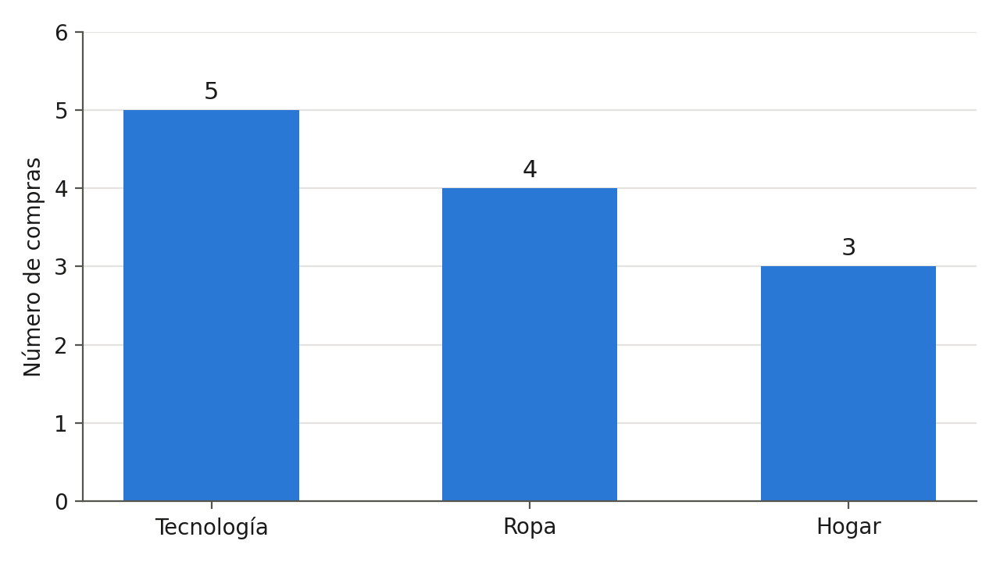
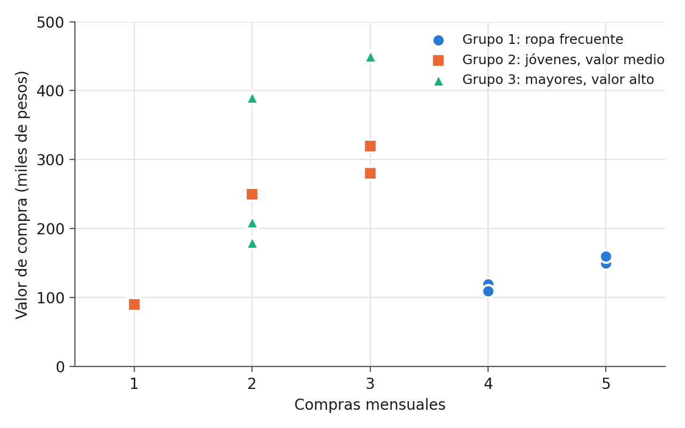

# Taller 3: minería de datos y descubrimiento de patrones

Inteligencia de Negocios, Universidad Manuela Beltrán, octubre de 2026.
Integrantes: Andrés Felipe Tabares Benavides y Kevin Santiago García.

Este es el código en Python del taller. Trabaja con las 12 compras del caso de la guía y hace el análisis en el mismo orden de la actividad, desde la preparación de los datos hasta los dos gráficos que pide la Fase 3. Lo hicimos con Pandas y Matplotlib, que son las herramientas que sugiere la guía, y para el agrupamiento usamos K-means de scikit-learn.

## Qué hace

| Parte de la guía | Qué calcula |
|---|---|
| Actividad 1 | Tipos de variables, datos faltantes, identificadores repetidos y el valor de compra, que viene como texto ($250.000) y toca pasarlo a número |
| Actividad 2 | Las cinco preguntas del análisis exploratorio: producto, valor promedio, ciudad, grupo de edad y relación entre frecuencia y valor |
| Actividad 3 | Clasificación por rangos de valor (baja, media y alta) y agrupamiento con K-means, probando de 2 a 5 grupos con la silueta |
| Fase 3 | Gráfico de barras de compras por producto y gráfico de dispersión de valor contra frecuencia mensual |

## Cómo correrlo

```
pip install -r requirements.txt
python taller3_mineria.py
```

En Google Colab no hay que instalar nada. Se sube el archivo y se corre con `!python taller3_mineria.py`.

Al correrlo imprime los resultados en pantalla, guarda los dos gráficos en la carpeta `figuras` y arma `reporte_taller3.html`, un reporte con todas las tablas y los dos gráficos que se abre solo en el navegador. Si no se quiere que lo abra, se corre con `python taller3_mineria.py --sin-abrir`. En Colab el reporte queda en los archivos de la sesión y de ahí se descarga.

En `salida.txt` está lo que imprime cuando se corre, que son las mismas cifras del documento entregado y del archivo de Excel. El reporte de este repositorio ya viene generado, para verlo basta con descargarlo y abrirlo.

## Gráficos




